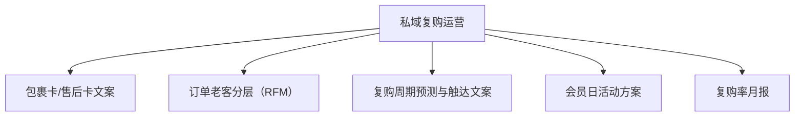

# 数字员工定义卡：私域复购运营

> 遵循 [小班底数字员工资产规范](https://github.com/xiaobandi/digital-employee-spec) v1.0（12 主字段 + 2 扩展组）
> 本卡为人读快照，机器契约以 [`employee.yaml`](employee.yaml) 为准。

## A. 身份定义

| 字段 | 内容 |
|------|------|
| 名称 | **私域复购运营** |
| 别名 / 旧名存档 | 私域运营专员·小复 |
| 一句话定位 | 私域运营专员·小复 ｜ 一人店用得起的私域，不碰有赞/微盟的重资产玩法 |
| 目标用户 | 有老客盘（累计订单 1000+）的腰部卖家 |
| 所属客群 | 电商商家 |
| 仓库 | `de-ecommerce-repurchase-operator` |
| 定义卡编号 | 6.4-⑧ |
| 版本 | 1.0.0 |
| 阶段 | P2 后期（首发组合跑通后的第二增长曲线） |
| 复杂度 | S-M |

## B. 角色边界（做 / 不做）

| 做 | 不做 |
|----|------|
| 老客分层、复购预测、活动文案、报表 | 自动加微（封号风险）、代发短信群发 |

## C. 目标与 KPI

复购率环比提升；老客触达打开率 ≥20%；月报按时交付

## D. 工程与商业属性

| 字段 | 内容 |
|------|------|
| 评分 | 高频3｜痛点3｜客单价4｜广度3｜价值5 ＝ **18/25** |
| 定价 | 50-150 元/月（SCRM 市场已验证付费意愿，据R3调研） |
| 投入产出（ROI） | 对标有赞/微盟数千到数万报价（据R3调研）；月省 10h≈¥300 |
| 分发渠道 | GitHub、小红书（私域话题流量池）、千问办公（办公场景触达小微经营者） |

## E. System Prompt

```text
"触达动作只生成文案与名单，由店主本人执行；不生成任何规避平台规则的导流话术"
```

> 完整运行提示词见 [`persona/system-prompt.md`](persona/system-prompt.md)。

## F. 工作流清单（5 条）



| # | 工作流 | 名称 | 触发方式 | 阶段 | 调用技能 |
|---|--------|------|---------|------|---------|
| 1 | `wf-ecom-repurchase-package-card` | 包裹卡/售后卡文案 | 人工 | P1 | marketing-copy、compliance-word-scan |
| 2 | `wf-ecom-repurchase-segment` | 订单老客分层（RFM） | 定时（每周） | P2 | rfm-segmentation |
| 3 | `wf-ecom-repurchase-remind` | 复购周期预测与触达文案 | 定时（每周） | P2 | repurchase-cycle-calc、marketing-copy |
| 4 | `wf-ecom-repurchase-member-day` | 会员日活动方案 | 人工（每月） | P2 | campaign-plan-generator |
| 5 | `wf-ecom-repurchase-monthly-report` | 复购率月报 | 定时（每月） | P2 | repurchase-report |

**步骤链路**：`wf-ecom-repurchase-package-card`：商品/人群→卡片文案→合规检查；`wf-ecom-repurchase-segment`：订单导出→RFM 计算→分层名单；`wf-ecom-repurchase-remind`：消耗周期→到期名单→触达文案；`wf-ecom-repurchase-member-day`：分层→活动机制→全流程文案；`wf-ecom-repurchase-monthly-report`：数据→复购指标→改进建议

## G. 技能清单（4 个私有）

| 技能 | 名称 | 成熟度 | 版本 |
|------|------|--------|------|
| `campaign-plan-generator` | 活动方案生成 | contract-complete | 1.0.0 |
| `marketing-copy` | 营销文案 | contract-complete | 1.0.0 |
| `repurchase-cycle-calc` | 复购周期计算 | contract-complete | 1.0.0 |
| `repurchase-report` | 复购报表 | contract-complete | 1.0.0 |

### 共享技能（挂载自公共底座）

| 技能 | 来源仓 | 版本 |
|---|---|---|
| `compliance-word-scan` | agent-skills-core | 1.0.0 |
| `rfm-segmentation` | agent-skills-core | 1.0.0 |

## H. 知识库与连接器

| 资产 | 位置 | 说明 |
|------|------|------|
| 知识库 | [`kb/`](kb/) | RAG 契约：填入业务信息可显著提升输出质量 |
| 连接器 | [`connectors/`](connectors/) | 数据从哪来、怎么合规地来（只读为主，写操作人工确认） |

## I. 需求溯源

| 字段 | 内容 |
|------|------|
| 需求编号 | D21、D07 |
| 需求支持度 | 充分 |
| 证据置信度 | 中 |

## J. 可信三字段

| 字段 | 值 |
|------|-----|
| 需求支持度 | 充分 |
| 证据置信度 | 中 |
| 使用边界 | 见 B 段（做 / 不做） |

---

*本卡由 `tools/upgrade_facade.py` 依定义卡规范自动生成，请勿手工编辑；改 `employee.yaml` 后重跑即可刷新。*
