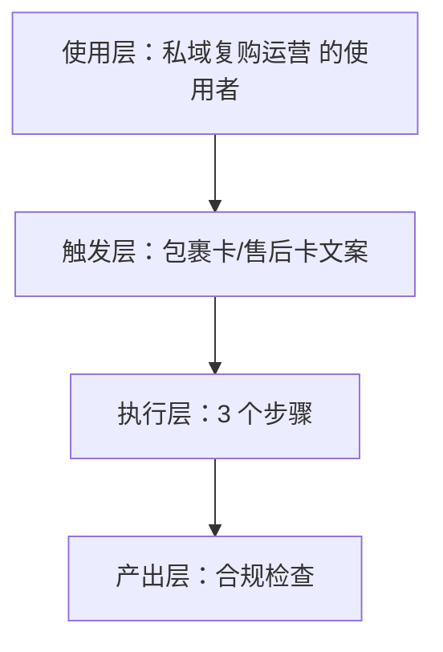
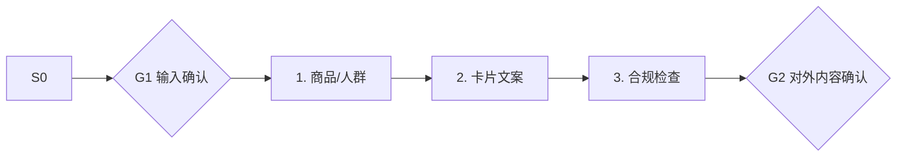

# 包裹卡/售后卡文案 · 架构与流程图

## 本工作流的四层结构

| 层 | 内容 |
|---|---|
| 使用层 | 有老客盘（累计订单 1000+）的腰部卖家；员工定位：私域运营专员·小复 ｜ 一人店用得起的私域，不碰有赞/微盟的重资产玩法 |
| 触发层 | 关键词 / 显式点名「包裹卡/售后卡文案」；触发方式：人工 |
| 执行层 | 商品/人群 → 卡片文案 → 合规检查 |
| 产出层 | 合规检查 |

## 执行流程

## 步骤职责表

| # | 步骤 | 承担者 | 为什么 |
|---|---|---|---|
| 1 | 商品/人群 | 模型 | 需要读懂语境，不可用固定规则替代 |
| 2 | 卡片文案 | 模型 | 需要读懂语境，不可用固定规则替代 |
| 3 | 合规检查 | 模型 | 需要读懂语境，不可用固定规则替代 |

⚠️ 尚未补齐：图中的步骤来自注册表口径，未逐条实跑校验；实跑后请同步修订本页（`发布标准.md` 第六项：通读一遍，不得出现重复填充句）。
